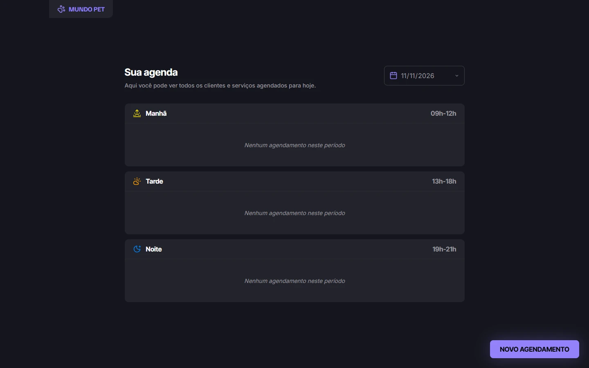
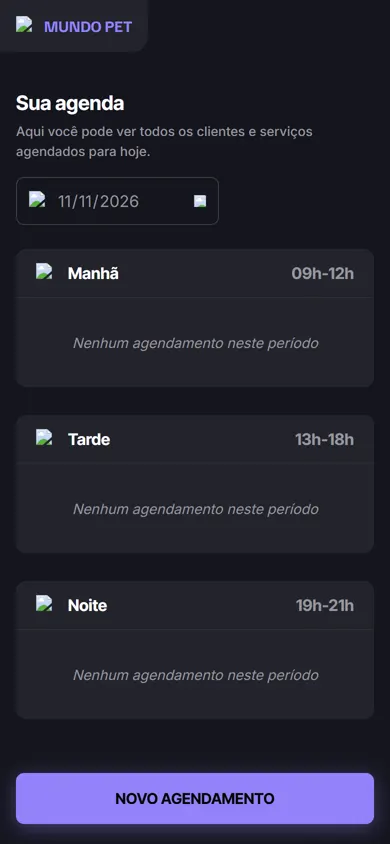

<div align="center">

# 🐾 Mundo Pet

**Agenda de atendimentos para pet shop, com validações e dados salvos no navegador**


[](LICENSE)
[](https://kevinlopes23.github.io/Mundo-Pet/)

<br>

&nbsp;


</div>

## 💡 Sobre

Sistema de agendamento para pet shop feito com JavaScript puro. Mostra a agenda do dia separada por período e permite cadastrar e remover atendimentos, com os dados guardados no `localStorage`.

## ✨ Funcionalidades

- Agenda por data, agrupada em manhã (09h–12h), tarde (13h–18h) e noite (19h–21h)
- Modal de novo agendamento: tutor, pet, telefone, serviço, data e hora
- Validações: campos obrigatórios, horário dentro do expediente e sem conflito
- Remoção com confirmação
- Persistência no `localStorage`
- Layout responsivo baseado em design do Figma

## 🛠️ Tecnologias

HTML5 · CSS3 · JavaScript (classes ES6+) · localStorage

## 🚀 Como rodar

Projeto estático, sem build:

```bash
git clone https://github.com/KevinLopes23/Mundo-Pet.git
cd Mundo-Pet
```

Abra o `index.html` no navegador (ou use uma extensão como Live Server).

Documentação extra do projeto: [INDEX.md](INDEX.md).

## 📄 Licença

Distribuído sob a licença MIT. Veja [LICENSE](LICENSE).

## 👤 Autor

Feito por [Kevin Lopes](https://github.com/KevinLopes23)
