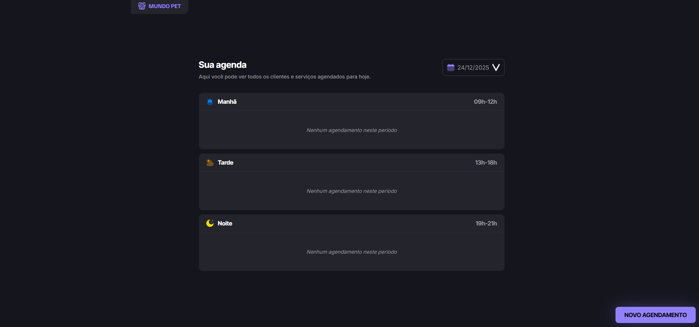
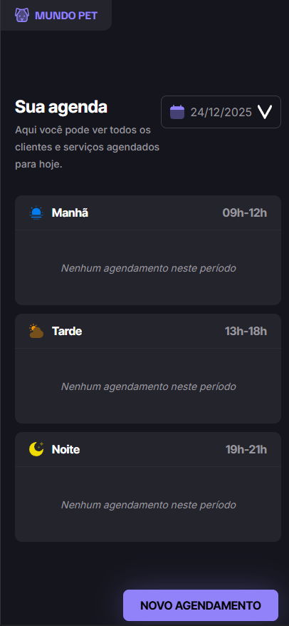

<div align="center">

# 🐾 Mundo Pet

### Sistema de Agendamento para Petshop

[](LICENSE)
[](https://developer.mozilla.org/en-US/docs/Web/HTML)
[](https://developer.mozilla.org/en-US/docs/Web/CSS)
[](https://developer.mozilla.org/en-US/docs/Web/JavaScript)

[Demo](https://seu-usuario.github.io/Mundo-Pet) • [Documentação](./INDEX.md) • [Contribuir](./CONTRIBUTING.md)



<details>
<summary>📱 Ver versão mobile</summary>
<br>

</details>

</div>

---

## 📖 Sobre o Projeto

Sistema web moderno e intuitivo para gerenciamento de agendamentos em petshops. Desenvolvido com foco em experiência do usuário, validações robustas e interface responsiva baseada em design do Figma.

## 📋 Funcionalidades Implementadas

### ✅ Visualização de Agendamentos

- **Agrupamento por período**: Manhã (09h-12h), Tarde (13h-18h) e Noite (19h-21h)
- **Ordenação automática**: Agendamentos ordenados por horário
- **Informações completas**: Horário, nome do pet, tutor e descrição do serviço
- **Filtro por data**: Visualize agendamentos de datas específicas

### ✅ Modal de Novo Agendamento

- **Campos obrigatórios**:

  - Nome do tutor
  - Nome do pet
  - Telefone
  - Descrição do serviço
  - Data
  - Hora

- **Validações implementadas**:
  - ⚠️ Todos os campos são obrigatórios
  - ⏰ Horário deve estar dentro das janelas permitidas
  - 🚫 Não permite agendamentos duplicados no mesmo horário
  - 🎯 Foco automático no primeiro campo ao abrir o modal

### ✅ Gerenciamento de Agendamentos

- **Adicionar**: Criar novos agendamentos com validação completa
- **Remover**: Excluir agendamentos com confirmação
- **Persistência**: Dados salvos automaticamente no localStorage
- **Feedback visual**: Mensagens de sucesso e erro

## 🏗️ Arquitetura do Sistema

### Estrutura de Arquivos

```
Mundo-Pet/
├── index.html              # Interface principal
├── styles/
│   ├── global.css         # Variáveis e estilos globais
│   └── index.css          # Estilos específicos da página
├── scripts/
│   └── app.js             # Lógica de negócio completa
└── assets/                # Recursos visuais
```

### Componentes Principais

#### 1. **ScheduleManager** (Classe de Gerenciamento)

Responsável por toda a lógica de negócio:

```javascript
// Métodos principais:
-addSchedule(data) - // Adicionar agendamento
  removeSchedule(date, id) - // Remover agendamento
  getSchedulesByDate(date) - // Buscar por data
  validateTime(time) - // Validar horário
  hasConflict(date, time); // Verificar conflitos
```

**Validações**:

- ✅ Campos obrigatórios
- ✅ Horário dentro das janelas permitidas
- ✅ Sem conflitos de horário

#### 2. **ScheduleUI** (Classe de Interface)

Gerencia toda a interação com o usuário:

```javascript
// Métodos principais:
-renderSchedules() - // Renderizar lista
  openModal() - // Abrir modal
  closeModal() - // Fechar modal
  handleFormSubmit(event) - // Processar formulário
  handleRemoveSchedule(id); // Remover agendamento
```

## 🔧 Regras de Negócio

### Janelas de Atendimento

| Período | Horário |
| ------- | ------- |
| Manhã   | 09h-12h |
| Tarde   | 13h-18h |
| Noite   | 19h-21h |

### Validações

1. **Horário válido**: Deve estar dentro das janelas acima
2. **Sem conflitos**: Não pode haver dois agendamentos no mesmo horário e data
3. **Campos obrigatórios**: Todos os campos devem ser preenchidos
4. **Ordenação**: Agendamentos são automaticamente ordenados por horário

## 💾 Persistência de Dados

Os dados são salvos automaticamente no **localStorage** do navegador:

```javascript
// Estrutura de dados:
{
  "10/01/2024": [
    {
      "id": 1640000000000,
      "ownerName": "Helena Souza",
      "petName": "Cheddar",
      "phone": "(00) 0 0000-0000",
      "service": "Banho e tosa",
      "date": "10/01/2024",
      "time": "14:00",
      "period": "AFTERNOON"
    }
  ]
}
```

## 🎨 Interface do Usuário

### Interações

- **Abrir modal**: Clique em "NOVO AGENDAMENTO"
- **Fechar modal**:
  - Clique fora do modal (overlay)
  - Pressione ESC
  - Após submeter o formulário
- **Remover agendamento**: Clique em "Remover agendamento" e confirme

### Feedback Visual

- ✅ Mensagem verde de sucesso (3 segundos)
- ❌ Mensagem vermelha de erro (3 segundos)
- ⚠️ Confirmação antes de remover
- 📝 Mensagem quando não há agendamentos

## 🚀 Como Usar

1. **Abra o arquivo `index.html`** no navegador

2. **Criar um agendamento**:

   - Clique em "NOVO AGENDAMENTO"
   - Preencha todos os campos
   - Clique em "AGENDAR"

3. **Visualizar agendamentos**:

   - Veja os agendamentos organizados por período
   - Mude a data para ver outros dias

4. **Remover agendamento**:
   - Clique em "Remover agendamento"
   - Confirme a ação

## 🛠️ Tecnologias Utilizadas

- **HTML5**: Estrutura semântica
- **CSS3**: Estilização com variáveis CSS e animações
- **JavaScript (ES6+)**: Classes, arrow functions, destructuring
- **LocalStorage**: Persistência de dados
- **Google Fonts**: Inter, Inter Tight, Familjen Grotesk

## 📱 Responsividade

O sistema é totalmente responsivo e se adapta a diferentes tamanhos de tela.

## � Começando

### Pré-requisitos

Apenas um navegador web moderno (Chrome, Firefox, Safari, Edge).

### Instalação

1. Clone o repositório:

```bash
git clone https://github.com/seu-usuario/Mundo-Pet.git
```

2. Entre na pasta do projeto:

```bash
cd Mundo-Pet
```

3. Abra o arquivo [index.html](index.html) no navegador:

```bash
# No Windows
start index.html

# No macOS
open index.html

# No Linux
xdg-open index.html
```

**Ou** simplesmente abra o arquivo `index.html` diretamente no navegador.

### Dados de Teste

Para testar o sistema com dados de exemplo:

1. Abra [index.html](index.html) no navegador
2. Abra o Console do navegador (F12)
3. Execute:

```javascript
// Carregar script de dados de exemplo
const script = document.createElement("script");
script.src = "scripts/sample-data.js";
document.body.appendChild(script);
```

Ou abra [test.html](test.html) para uma interface de testes completa.

## 📚 Documentação

- **[INDEX.md](INDEX.md)** - Índice completo de todos os arquivos
- **[GUIA.md](GUIA.md)** - Guia completo do usuário
- **[API.md](API.md)** - Documentação da API JavaScript
- **[BACKEND_SUMMARY.md](BACKEND_SUMMARY.md)** - Resumo da implementação
- **[CONTRIBUTING.md](CONTRIBUTING.md)** - Guia de contribuição

## 🎯 Funcionalidades

### ✅ Visualização de Agendamentos

- 📅 Agrupamento automático por período (Manhã/Tarde/Noite)
- 🔢 Ordenação automática por horário
- 📋 Informações completas (horário, pet, tutor, serviço)
- 📆 Filtro por data com seletor visual

### ✅ Novo Agendamento

- ✍️ Modal intuitivo com 6 campos
- ⚠️ Validação em tempo real
- 🚫 Prevenção de conflitos de horário
- ✅ Feedback visual de sucesso/erro

### ✅ Gerenciamento

- ➕ Adicionar com validação completa
- ❌ Remover com confirmação
- 💾 Persistência automática (localStorage)
- 🔄 Sincronização em tempo real

## ⚙️ Validações Implementadas

| Validação               | Descrição                                            |
| ----------------------- | ---------------------------------------------------- |
| **Campos obrigatórios** | Todos os 6 campos devem ser preenchidos              |
| **Janelas de tempo**    | Horário deve estar entre 9h-12h, 13h-18h ou 19h-21h  |
| **Conflitos**           | Não permite agendamentos duplicados no mesmo horário |
| **Formato de data**     | Validação automática do tipo `date`                  |
| **Formato de hora**     | Validação automática do tipo `time`                  |
| **Telefone**            | Campo tipo `tel` com padrão brasileiro               |

## 🏗️ Arquitetura

```
┌─────────────────────────────────────┐
│         Interface (HTML)            │
│  - index.html (Página principal)    │
│  - Modal de agendamento             │
│  - Listagem por período             │
└──────────────┬──────────────────────┘
               │
┌──────────────▼──────────────────────┐
│       Camada Visual (CSS)           │
│  - global.css (Variáveis)           │
│  - index.css (Componentes)          │
│  - Animações e responsividade       │
└──────────────┬──────────────────────┘
               │
┌──────────────▼──────────────────────┐
│     Lógica de Negócio (JS)          │
│                                     │
│  ┌─────────────────────────────┐   │
│  │   ScheduleManager           │   │
│  │  - addSchedule()            │   │
│  │  - removeSchedule()         │   │
│  │  - validateTime()           │   │
│  │  - hasConflict()            │   │
│  └─────────────────────────────┘   │
│                                     │
│  ┌─────────────────────────────┐   │
│  │   ScheduleUI                │   │
│  │  - renderSchedules()        │   │
│  │  - openModal()              │   │
│  │  - handleFormSubmit()       │   │
│  └─────────────────────────────┘   │
└──────────────┬──────────────────────┘
               │
┌──────────────▼──────────────────────┐
│    Persistência (localStorage)      │
│  - Salvamento automático            │
│  - Estrutura JSON por data          │
└─────────────────────────────────────┘
```

## 🎨 Design System

### Cores

| Uso                   | Hex       | Variável CSS             |
| --------------------- | --------- | ------------------------ |
| Background Principal  | `#151515` | `--background`           |
| Background Secundário | `#1e1e1e` | `--background-secondary` |
| Background Terciário  | `#23242c` | `--background-tertiary`  |
| Cor Primária (Brand)  | `#9282fa` | `--primary-color`        |
| Texto Principal       | `#ffffff` | `--content-primary`      |
| Texto Secundário      | `#98959d` | `--content-secondary`    |
| Borda                 | `#3e3c41` | `--border-primary`       |

### Tipografia

- **Familjen Grotesk** (700) - Títulos
- **Inter Tight** (700) - Subtítulos
- **Inter** (400, 500, 600, 700) - Corpo do texto

## 🧪 Testes

Execute os testes abrindo [test.html](test.html) no navegador.

**Casos de teste incluídos:**

- ✅ Validação de horários
- ✅ Detecção de conflitos
- ✅ Agrupamento por período
- ✅ Persistência de dados
- ✅ Adição de agendamentos
- ✅ Remoção de agendamentos
- ✅ Validação de campos obrigatórios
- ✅ Interface de modal

## 🔮 Roadmap

### Versão 2.0 (Planejado)

- [ ] 🔐 Backend real com API RESTful
- [ ] 🗄️ Banco de dados (MongoDB/PostgreSQL)
- [ ] 👤 Sistema de autenticação
- [ ] 📧 Notificações por email/SMS
- [ ] 📊 Dashboard com estatísticas

### Versão 1.x (Melhorias)

- [ ] 🌙 Modo claro/escuro
- [ ] 📱 PWA (Progressive Web App)
- [ ] 📥 Exportar agendamentos (PDF/CSV)
- [ ] 🔍 Busca avançada
- [ ] 📅 Integração com Google Calendar
- [ ] 🔔 Lembretes automáticos
- [ ] 📝 Histórico de edições
- [ ] 🎨 Personalização de temas
- [ ] 🌐 Internacionalização (i18n)
- [ ] ♿ Melhorias de acessibilidade

## 🤝 Contribuindo

Contribuições são bem-vindas! Veja o guia [CONTRIBUTING.md](CONTRIBUTING.md) para mais detalhes.

1. Faça um Fork do projeto
2. Crie uma branch para sua feature (`git checkout -b feature/NovaFuncionalidade`)
3. Commit suas mudanças (`git commit -m 'feat: adiciona nova funcionalidade'`)
4. Push para a branch (`git push origin feature/NovaFuncionalidade`)
5. Abra um Pull Request

## 👥 Autores

- **Seu Nome** - _Trabalho Inicial_ - [@seu-usuario](https://github.com/seu-usuario)

Veja também a lista de [contribuidores](https://github.com/seu-usuario/Mundo-Pet/contributors) que participaram deste projeto.

## 📞 Suporte

Se você tiver alguma dúvida ou problema:

- 🐛 [Abra uma issue](https://github.com/seu-usuario/Mundo-Pet/issues)
- 💬 [Inicie uma discussão](https://github.com/seu-usuario/Mundo-Pet/discussions)
- 📧 Entre em contato: seu-email@exemplo.com

## ⭐ Mostre seu apoio

Se este projeto foi útil para você, considere dar uma ⭐️!

## 📝 Licença

Este projeto está sob a licença MIT. Veja o arquivo [LICENSE](LICENSE) para mais detalhes.

---

<div align="center">

**Desenvolvido com ❤️ e ☕ para o Mundo Pet**

🐕 🐈 🐦 🐰 🐹

[⬆ Voltar ao topo](#-mundo-pet)

</div>
